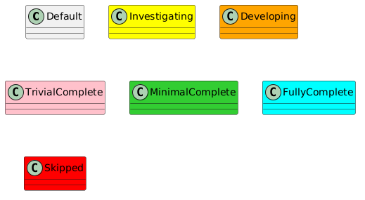
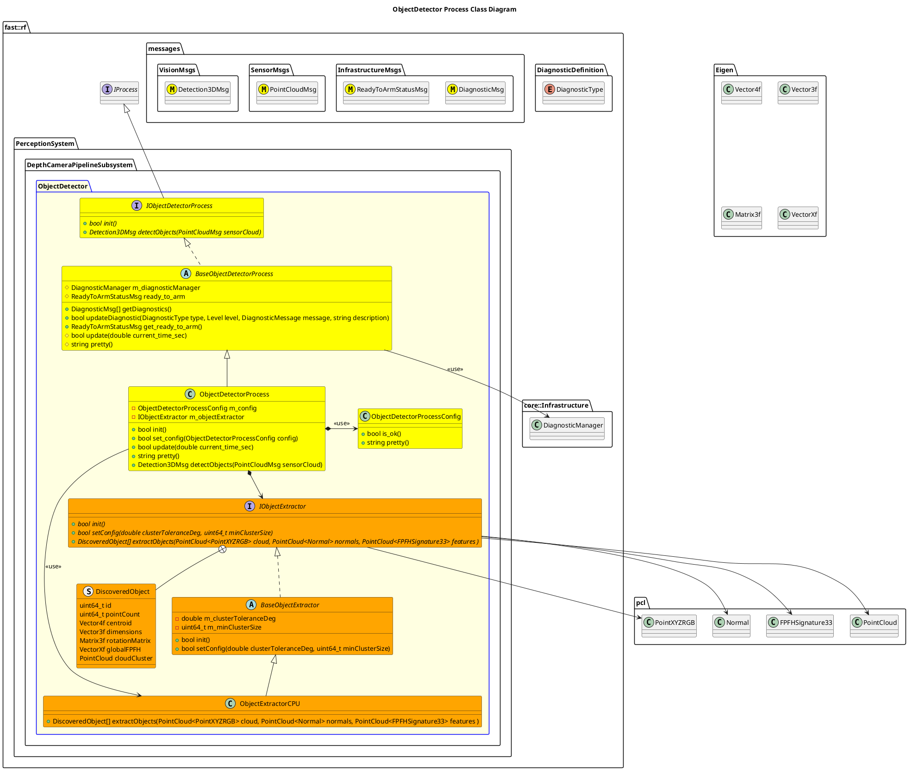

`@compare_tag Process-Document v0.1`

[DepthCameraPipeline Subsystem](../../../doc/Subsystem-DepthCameraPipeline.md)

- [Process: ObjectDetector](#process-objectdetector)
- [Overview](#overview)
  - [Purpose](#purpose)
  - [General Requirements](#general-requirements)
- [Inputs](#inputs)
- [Outputs](#outputs)
- [Diagnostics](#diagnostics)
- [How It Works](#how-it-works)
  - [Detailed Documentation](#detailed-documentation)
  - [Class Diagram](#class-diagram)
- [Usage Instructions](#usage-instructions)
  - [Test Data Creation](#test-data-creation)
- [Validation](#validation)

# Process: ObjectDetector

# Overview

## Purpose

This process's objective is to consume a down-sampled Point Cloud and return a list of discovered objects in that point cloud.

## General Requirements
| Requirement | Description |
| ----------- | ----------- |

# Inputs

The following inputs are required in order for this system to properly function.

| Input | DataType | Description | Requirement |
| ----- | -------- | ----------- | ----------- |

# Outputs

The following outputs are provided by this system.

| Output | DataType | Description | Usage |
| ------ | -------- | ----------- | ----- |

# Diagnostics
Processes in this Subsystem are defined by:
- System: `PerceptionSystem::SYSTEM_ID`
- Subsystem: `PerceptionSystem::DepthCameraPipelineSubsystem::SUBSYSTEM_ID`
- Process: `PerceptionSystem::DepthCameraPipelineSubsystem::PROCESS_OBJECTDETECTOR_ID`

The following Diagnostics are reported by this Process:
| Diagnostic Type | Description                                                                                          |
| --------------- | ---------------------------------------------------------------------------------------------------- |
|                 | Trips in the following situations: Input Cloud is too large (indicats it's not down-sampled enough). |

# How It Works

## Detailed Documentation



## Class Diagram




# Usage Instructions
## Test Data Creation
A Python Script is created to generate test data.  Run it by:
```python
python generate_point_cloud.py
```
# Validation
